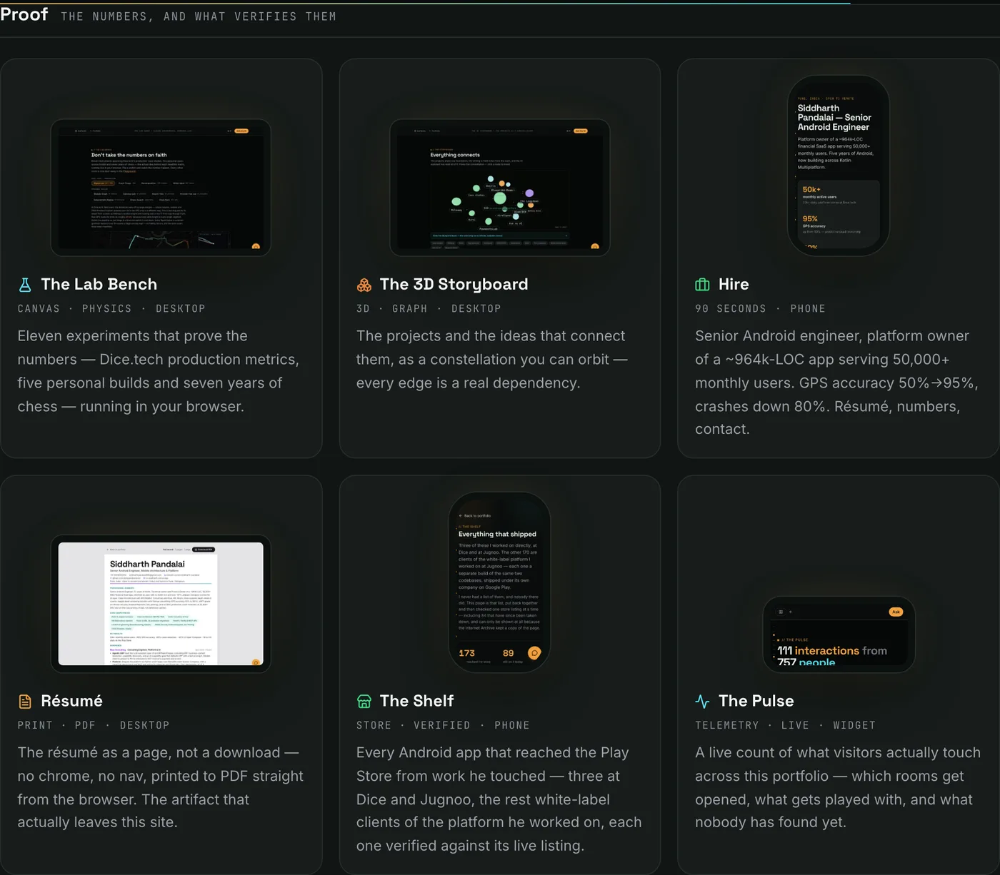

# cv-siddharth

<p align="center">
  
</p>

**Live: [siddharth-pandalai.vercel.app](https://siddharth-pandalai.vercel.app/)**. The Vercel project was renamed from cv-siddharth, and the old address [cv-siddharth.vercel.app](https://cv-siddharth.vercel.app/) still works as an alias, so old links keep resolving.

My portfolio, built as a site you can poke at rather than a page of bullet points. It has case studies with production numbers, Kotlin Multiplatform apps running as WebAssembly inside the page, a résumé view laid out for A4 that prints to PDF from the browser ([/resume](https://siddharth-pandalai.vercel.app/resume)), and a chat assistant called Panda that answers questions about my experience in the third person.

The idea came from [santifer/cv-santiago](https://github.com/santifer/cv-santiago). I rebuilt it smaller: the whole CV fits in a model's context, so there is no retrieval step. What Panda knows lives in one generated system prompt, [api/_lib/system-prompt.ts](api/_lib/system-prompt.ts).

## Stack

React 19, TypeScript 7, Vite 8, TanStack Start, Tailwind v4, hosted on Vercel. The chat backend is provider-agnostic: four providers sit behind one SSE format, so the widget never knows which answered: **Google Gemini**, **Cerebras**,
**Groq** and **Anthropic Claude**. Whichever keys are configured are tried in
order, with fallback on failure; model names are overridable per provider
(`GROQ_MODEL`, `GEMINI_MODEL`, `CEREBRAS_MODEL`, `ANTHROPIC_MODEL`).

The order is chosen per request by prompt size. `providerOrderFor()` sends anything above `GROQ_TPM_HEADROOM` (7,000 estimated tokens, about 4 characters each) to the roomier providers first. The generated prompt file `api/_lib/system-prompt.ts` is 30,479 bytes, so the prompt alone is already past that line and chat requests normally lead with Gemini, with Groq taking the short non-chat modes. `system-prompt.test.ts` caps the prompt's size so it cannot quietly regrow, and `chat-handler.test.ts` records where it sits against the headroom. If Groq-first matters, the fix is a smaller prompt, not a reordered list.

TypeScript here is 7.0.2 (`npx tsc --version`). `typescript-eslint` cannot read the TS 7 compiler API yet, so `package.json` installs two packages side by side: `@typescript/native` for `tsc` and `@typescript/typescript6` as the `typescript` that lint sees. If lint complains that typescript-eslint does not support TS 7, run `npx tsc --version` first; anything other than 7.0.2 means `npm install` lost the race for the `tsc` binary, and running it again fixes it.

## Quick start

```bash
npm install
cp .env.local.example .env.local   # add a chat key to enable Panda
npm run dev
```

Open http://localhost:5173. The site works without a key; the chat widget
shows a contact fallback until one of `GROQ_API_KEY` / `GEMINI_API_KEY` /
`CEREBRAS_API_KEY` / `ANTHROPIC_API_KEY` is set. In dev, a Vite middleware
([vite.config.ts](vite.config.ts)) serves `/api/chat` with the same handler
Vercel runs in production, so no `vercel dev` is needed.

## The surfaces

The site has **twenty-three destinations**, each its own route. The homepage renders every one of them as a tile in the
device frame it is best seen in, and the same grid is reachable from anywhere
via the **Surfaces** launcher in the nav. ⌘K searches by name; the launcher
shows what exists, and you cannot search for a room you do not know about.

Some routes are **rooms**: they join a shared next-room pager (`/chess`,
`/lab`, `/blueprint`, `/compose`, `/forge`, `/map`, `/terminal`, `/weeb`, and
the drivable `/playground` world), so moving between them never bounces
through the homepage. Every route also carries the **rail**, a live trace
pinned to the left edge (`AnomalyRail`): a repeating baseline scale with each
facet plotted on it at its real chronological position, expanding into a
full instrument view on drag or the `\` key. `docs/route-systemisation.md` is
the mechanically-checked table of which route is which (room or page, fast,
deep or wandering reading path, reachable from the facet registry or the
sitemap or both), and `routeSystemisation.test.ts` fails the build if a route
falls through it unregistered.

<p align="center">
  
  <br/>
  <sub><i>One group of four. Each poster is the route captured at that device's own viewport, not a desktop screenshot cropped to shape.</i></sub>
</p>

| | | |
|---|---|---|
| [`/hire`](https://siddharth-pandalai.vercel.app/hire) | the 90-second version | numbers, résumé, contact. For someone who will not explore |
| [`/resume`](https://siddharth-pandalai.vercel.app/resume) | print · pdf | A4 `@page`, no chrome, straight to PDF from the browser |
| [`/shipped`](https://siddharth-pandalai.vercel.app/shipped) | store · verified | every Android app that reached Play from work he touched, each checked against its live listing |
| [`/lab`](https://siddharth-pandalai.vercel.app/lab) | canvas · physics | **12 experiments** that prove the numbers: GPS filtering, crash triage, recomposition and module graphs, running in your browser |
| [`/pulse`](https://siddharth-pandalai.vercel.app/pulse) | telemetry · live | a live count of what visitors actually touch across the site |
| [`/compose`](https://siddharth-pandalai.vercel.app/compose) | live editor · AI | write Jetpack Compose, watch it recompose in a phone frame |
| [`/ops`](https://siddharth-pandalai.vercel.app/ops) | control loop · live | every workflow, every generated dataset against its own SLA, what is published and signed, and a ledger of the failures a green check did not catch |
| [`/blueprint`](https://siddharth-pandalai.vercel.app/blueprint) | 3D · WebGL | the portfolio as an infinite canvas: a three.js fly-through, an ASCII render of the same scene, and a sketchable tldraw whiteboard |
| [`/map`](https://siddharth-pandalai.vercel.app/map) | 3D · graph | the projects and the ideas connecting them, as an orbitable constellation |
| [`/globe`](https://siddharth-pandalai.vercel.app/globe) | 3D · live | real Earth, dot by dot: day and night from the actual subsolar point, reach numbers as light columns over Pune, who else is here right now |
| [`/forge`](https://siddharth-pandalai.vercel.app/forge) | canvas · interactive | a few thousand particles spring-tied to a letter, parting around the cursor |
| [`/terminal`](https://siddharth-pandalai.vercel.app/terminal) | text · easter egg | a faux shell you can type in: `ls`, `open doori`, `ask <q>`, `chess clock`. Backtick summons it from any route |
| [`/playground`](https://siddharth-pandalai.vercel.app/playground) | 3d world · drivable | every room as a building on one street, drivable in 3D; north is 2017, south is now, and a West District turns his employers and case studies into towers |
| [`/chess`](https://siddharth-pandalai.vercel.app/chess) | 3d · engine | seven years across lichess and chess.com, mined: the rating arc in 3D, a shifting repertoire, a bot that plays like him |
| [`/weeb`](https://siddharth-pandalai.vercel.app/weeb) | corpus · data | a hand-kept anime list read as evidence, a status column with no word for quitting |
| [`/ink`](https://siddharth-pandalai.vercel.app/ink) | archive · world | the writing years, before the code |
| [`/excelsior`](https://siddharth-pandalai.vercel.app/excelsior) | 396 pages | three editions of MANIT's institute magazine, page-turnable in full |
| [`/loopdown`](https://siddharth-pandalai.vercel.app/loopdown) | field notes | what broke in production, what the fix was, and the numbers on either side |
| [`/anthology`](https://siddharth-pandalai.vercel.app/anthology) | fiction · starmap | The Morkinstar Journals, forty-eight short stories across four seasons, a navigable starmap and a lore page |
| [`/canon`](https://siddharth-pandalai.vercel.app/canon) | lore · reference | the rules the Morkinstar Journals are written against: seven laws, the count, the fourteen, and what the rendering can and cannot do |
| [`/making`](https://siddharth-pandalai.vercel.app/making) | process · receipts | the craft record for the anthology: cross-lab ownership audits, what they killed, two portrait passes, and what the whole thing cost |
| [`/lanes`](https://siddharth-pandalai.vercel.app/lanes) | corpus · timeline | work, open source, writing and chess, month by month since 2019, on one shared axis |
| [`/time-machine`](https://siddharth-pandalai.vercel.app/time-machine) | corpus · git history | this repo's own commit history, walked back month by month |

`/terminal`'s own `help` isn't the whole command list by design: nine
commands mark themselves `hidden` and skip it, so they stay things to find
rather than things to read off a screen.

Plus, on the scroll itself:

- **The multiplatform section**. Five WebAssembly apps are served from `heavy/`: the Compose builds of Doori, Gaddi, PaymentsLab-KMP and
  this site's own [Compose twin](https://github.com/darkpandawarrior/cv-siddharth-kmp), plus the Godot export of Stutter. They are re-framed live
  across the real Android window size classes (compact / medium / expanded).
  One iframe, so changing the form factor re-lays-out the running app instead
  of reloading it. Nothing boots until you click it.
- **Fit check**. Paste a job description and the assistant scores the fit
  honestly, gaps included. Same analyzer as `/jd` in the chat console.
- **Compare viewers**. On project pages, drag to compare two treatments of the
  same screen (light/dark, before/after) where genuine variants exist.
- **Per-project share cards**. Each `/project/<slug>` is server-rendered with
  its own OG/Twitter meta and a branded 1200×630 card (`/p/<slug>/og.png`).
- **Live Signal**. Spotify now-playing and recent GitHub activity, one polling
  hook feeding a footer chip, terminal commands (`spotify`/`np`, `activity`/`gh`)
  and a card on the Blueprint canvas. GitHub works keyless; Spotify needs
  `npm run spotify:auth` once. No keys, no crash, and every surface says
  "not connected".
- **`/read/<slug>`**. The magazine prose as selectable, searchable text rather
  than photographs of paper, each piece linked to the scanned page it ran on.
- **The Canon and The Making**. The anthology's reference shelf: the lore
  rules `/canon` gates behind a spoiler divider, and `/making`'s own record
  of building it, for a reader who wants to see how it was made.
- **EB Profiles**. One card per Editorial Board year, a teammate's
  in-character answer about him, each linking through to the scanned
  magazine page it came from. The same grid renders on the homepage and in
  full on `/ink`, from one component (`BoardProfilesGrid`).
- **A cross-site play layer**. A guest wall anyone can sign, per-piece margin
  notes on `/ink` and every `/read/<slug>`, and reaction rows, all shared
  documents backed by `playhtml`, not a per-visitor toy. `VITE_GUEST_WALL=off`
  removes the wall on the next deploy; nothing here calls a server of his.
- **The reality layer**. The footer's weather chip, `/pulse` and the world
  scene all read one shared `/api/weather` poll (`useWeather()`): real Pune
  temperature, condition and AQI from Open-Meteo, refused rather than shown
  once a reading fails a plausibility check. `/api/signals`, `/api/aircraft`
  and `/api/tle` feed the same "measured, not decorative" contract to the 3D
  world and the Blueprint canvas. Every one of these surfaces says so when a
  reading is unavailable, instead of freezing on the last good value.

## Open source

`scripts/gen-oss-stats.mjs` measures every upstream I have opened a PR against with `gh pr list`, not the search API (career-ops's rename makes search return 0 rows). The rows live in `src/data/careerOpsUpstream.ts` and render on the homepage under `#open-source` and on `/resume`. I do not copy the counts here, because they move daily: on 2026-11-06 `gh pr list -R career-ops-hq/career-ops --author darkpandawarrior` showed 29 merged, 6 open and 2 closed unmerged, while the committed data file still said 25 merged. The other upstream is Mifos (openMF): `kmp-project-template` (#298 and #299 merged), `mifos-passcode-cmp` (#82 open) and `mifos-x-actionhub` (#89 open).

## One registry

[`src/data/surfaces.ts`](src/data/surfaces.ts) is the single source for every
route on the site. It feeds the homepage wall, the launcher, the command
palette, the per-route `<head>`, the terminal's `go`/`ls`/`sitemap`, the
sitemap generator, the legacy-hash redirects and the assistant's prompt.

This was four registries and two hardcoded JSX lists. Every one of them
drifted. Nine finished routes were unreachable from the homepage, the palette
reached eleven of sixteen, and the legacy-hash map knew about nine. Adding a
surface now means one entry, and `surfaces.test.ts` derives the route list from
`src/routes/*.tsx` **on disk** and fails the build if a route has no surface, a
surface has no route, a declared poster is missing, an icon is absent or a
`railId` dangles.

## Deploy

Single target: Vercel hosts the TanStack Start server and the chat function
together.

```bash
npx vercel
```

Set at least one chat key in the Vercel project's environment variables.
`api/chat.ts` runs on the Edge runtime and streams SSE straight through to the
widget, with no separate chat host.

That endpoint spends the owner's API key, so it defends itself
([api/\_lib/chat-handler.ts](api/_lib/chat-handler.ts)): an **origin allowlist**
(the live site, this deployment's own Vercel hostnames so previews work,
localhost, plus anything in `ALLOWED_ORIGIN`. A request with no `Origin` header
is refused), a **per-IP rate limit** (`CHAT_RATE_PER_MIN`, default 10;
`CHAT_RATE_PER_HOUR`, default 60 → `429` + `Retry-After`), and **payload caps**
(≤60 messages, ≤64 KB body, ≤2000 chars per user turn, history trimmed before
it reaches a provider). The rate limiter is per-isolate and
therefore best-effort. See the comment above it for what a durable version
would take. `vercel.json` pins the SSR function to `bom1` (Mumbai)
and sets long-lived immutable caching for the WASM lab bundles; TanStack
Start's own router handles all page routing, so there's no rewrite rule to
maintain.

Four more endpoints carry a live credential of their own (`/api/ops`,
`/api/pipeline`, `/api/github-activity`, `/api/spotify` spend the owner's
`GITHUB_TOKEN` or a Spotify OAuth exchange) and share the same origin
allowlist and a per-IP sliding-window rate limit through one extracted module,
[api/\_lib/guard.ts](api/_lib/guard.ts): `guarded()` wraps a GET handler with
both in one import instead of a sixth hand-rolled copy. Unlike chat's POST, a
request with no `Origin` header is let through here: these are same-origin
`fetch()` calls a browser doesn't reliably attach one to, and refusing them
would 403 the site's own widgets.

Real-user monitoring is opt-in and off by default: set `VITE_SENTRY_DSN` and
[src/lib/monitoring.ts](src/lib/monitoring.ts) wires Sentry (Core Web Vitals
plus error tracking, 20% trace sample, `sendDefaultPii: false`) once, client
side, after hydration. Leave it unset and the module makes no network call
and loads no dependency code at all. `@vercel/analytics` (`<Analytics />` in
`__root.tsx`) is unconditional and needs no key.

## Structure

<details>
<summary><b>The map</b>: where the registries, the API and the generated data live</summary>
<br/>

```
api/
├── chat.ts                  # Vercel Edge entry
└── _lib/
    ├── chat-handler.ts      # Web-standard handler (shared dev/prod), 4 providers
    ├── system-prompt.ts     # GENERATED: Panda persona + CV knowledge
    └── jd-prompt.ts         # GENERATED: the fit-check analyzer
src/
├── App.tsx                  # The homepage sections, in scroll order
├── routes/                  # One file per route; the router derives from disk
├── data/
│   ├── surfaces.ts          # THE registry: every route, its tile, its device
│   ├── profile.ts           # CV content (single source of truth)
│   ├── labs.ts              # the 12 Lab Bench experiments
│   └── *.ts                 # GENERATED: chess, weeb, store, writing, galleries…
├── lib/navigation.ts        # section ids + hash classification
├── Launcher.tsx             # the wall, from anywhere
├── SurfaceWall.tsx          # the homepage grid
└── index.css                # Tailwind v4 theme tokens
e2e/                         # Playwright: a11y, nav, offline, visitors, smoke
scripts/                     # the generators + the capture/sentinel tooling
```

</details>

The five case-study projects this site embeds live and links to were renamed
2026-09-05, published `applicationId`s and package names kept so existing
installs are never orphaned: [Doori](https://github.com/darkpandawarrior/Doori)
(formerly Mileway), [Gaddi](https://github.com/darkpandawarrior/Gaddi)
(formerly Kursi), [PaymentsLab-KMP](https://github.com/darkpandawarrior/PaymentsLab-KMP)
(formerly PaymentsLab), Candidai (formerly HireSignal) and Stutter (formerly
DEADLOCK). The last two repos are private, so the case studies on the site are
the public view of them. `vercel.json`'s redirects keep every old `/project/<old-slug>`
and `/p/<old-slug>` link resolving to the current one.

## Generators

Forty `gen:` scripts over forty-six generator files produce everything on the site that is a number, a list or an image: stats, galleries, OG cards, the system prompt, the store history, the chess corpus. Nothing is hand-mirrored from `profile.ts` or the registry.

```bash
npm run refresh           # media sync plus every generator
npm run gen:system-prompt # rebuild Panda's prompt after editing profile.ts
npm run gen:og            # branded per-project OG cards (/p/<slug>/og.png)
npm run capture:site      # screenshot every route, feeds the sentinel
```

[scripts/generators.mjs](scripts/generators.mjs) declares each generator once, with its inputs, outputs and the pipelines it belongs to, and the prebuild chain, `refresh.mjs` and `check-generated.mjs` all derive from it. `generators.test.mjs` fails if a script has no node there, a node names a missing script, or a generated file is not a declared output. Some generators sit outside every chain on purpose, because they need a local tool (poppler, tesseract, Blender), a private checkout, or a large download. Each is listed with its reason in [docs/generators.md](docs/generators.md).

## Gates

The failure that keeps recurring in this repo is a hand-kept list that falls behind the thing it mirrors while every test stays green. The gates are built for that shape.

```bash
npm test          # 3392 unit tests across 355 files (vitest)
npm run test:e2e  # 1006 Playwright tests across 113 files, every registry route
npm run lint
npx tsc -b        # not --noEmit: different program, different config, misses errors the build fails on
npm run sentinel  # screenshots: blank, duplicate, uncaptured, orphaned, stale
```

Those two counts are not typed by hand. `scripts/gen-repo-stats.mjs` counts the suite with `vitest list` and writes `src/data/repoStats.ts` in the daily refresh; the homepage renders that file, and `src/data/readme.test.ts` fails if this README disagrees with it, or with the Playwright listing, the `gen:` script count, the route count or the surface table. The site once claimed 619 tests in 46 files when the suite had reached 812 in 73, which is why all of that exists. The numbers above match the committed `repoStats.ts` generated on 2026-11-06 and will move on the next refresh.

Nine workflows live in `.github/workflows`:

| Workflow | When | What it does |
|---|---|---|
| `ci.yml` | push to main, PRs | `tsc -b`, lint, unit tests, `check:generated`, `check:old-names`, `check:ai-wiring`, `vite build`, `check:budget` |
| `lighthouse.yml` | push to main, PRs | builds, runs the Playwright suite, then Lighthouse CI over 29 URLs, 3 runs each |
| `refresh-media.yml` | daily 06:17 UTC | pulls project media and stats from the app repos; opens a rolling PR |
| `refresh-twin.yml` | Mondays 05:41 UTC | rebuilds the embedded Compose twin (was daily until the 10 GB Vercel deployment cap) |
| `doctor.yml` | daily 07:30 UTC | checks every freshness SLA and files an issue per stale entry |
| `screenshot-sentinel.yml` | Mondays, and PRs touching a capture | runs the capture sentinel |
| `ai-golden-eval.yml` | Mondays | runs 5 job-description fixtures against a live model; records, never gates |
| `relay-volcanoes.yml` | Thursdays | copies a weekly RSS feed to a branch because the origin blocks Vercel and most runners |
| `publish-assets.yml` | push to main | rsyncs `heavy/` to the GitHub Pages repo |

The size gate is a ratchet. `budgets.json` holds a measured byte ceiling for the homepage's eager JS and for named chunks, `scripts/check-budget.mjs` fails when either grows, and raising a ceiling takes a reviewed edit. In `lighthouserc.json`, accessibility 1.00, SEO 0.95, layout shift, total byte weight and script size are errors. Performance, LCP, FCP and TBT are warnings, plus a second set of generous runner-calibrated errors on every URL except `/playground`. Details and the numbers are in [docs/perf-budgets.md](docs/perf-budgets.md).

Checks worth knowing by name:

- `surfaces.test.ts` compares the route list on disk with the registry.
- `navigation.spec.ts` reads section ids out of the rendered homepage and proves the command palette reaches every route.
- `a11y.spec.ts` runs axe on every route at desktop and 390px width.
- `beforeTheCode.test.ts` checks that every magazine citation points at a scan and a `/read` piece that exist.
- `claim-audit`, in my private tooling, re-checks every claim the site makes about my work before anything outward-facing ships.

## Rendering and vitals

Twenty-six of the twenty-eight route files server-render. Two stay client-only:
`/ops` and `/pulse`. `/ops` is client-only because every age on its board is
computed at load and a server render would ship a timestamp already wrong by
the time it is read; `/pulse`'s numbers come off a websocket, so there is
nothing meaningful to render on the server.

How that is kept fast, and the measured numbers, are in [docs/rendering-and-vitals.md](docs/rendering-and-vitals.md): immutable hashed assets, edge-cached HTML, an LCP element that never animates opacity, SSR import protection that fails the build, late hydration below the fold, and the move of the heavy assets to GitHub Pages. Those assets are served from `https://darkpandawarrior.github.io/cv` through one `heavy()` helper in [src/lib/assetBase.ts](src/lib/assetBase.ts); `VITE_HEAVY_ASSET_BASE=/` in `.env.local` points local dev at `heavy/` directly.

## Public surface

These identifiers are the site's API, whether or not they look like one.
Something else (a bookmark, a shared link, an agent's cached memory, this
repo's own `/agent-context.json`) depends on each one staying stable. Changing
one is a breaking change: ship a new version alongside it, never an edit in
place.

- `?path=` and its version prefix: the Blueprint Room canvas's saved-view
  encoding.
- `?world=`, `?at=`, `?focus=`: deep links into a world/lane/story position.
- The `/api/*` response shapes `public/agent-context.json` points agents at.
- The `playhtml` channel `geo-v1`: the shared, cross-viewer room state.
- `localStorage` key `world:lastSeen`: per-viewer world-visit state.
- The `heavy/` path layout (`heavy/<app>/...`): every heavy asset URL this
  site or an agent constructs.
- The `stars-hyg41-m5.bin` binary format: GLOBE's star catalogue.

## Data licences

- `src/data/osm/mutha.json` and `heavy/world/terrain/*`: [Open Database
  Licence 1.0](https://opendatacommons.org/licenses/odbl/1-0/) (ODbL),
  attribution to OpenStreetMap contributors: (c) OpenStreetMap contributors,
  https://www.openstreetmap.org/copyright.
- `public/sky/stars-hyg41-m5.bin`: [CC BY-SA
  4.0](https://creativecommons.org/licenses/by-sa/4.0/) (HYG database).
- Live `adsb.lol` and CelesTrak data is proxied at request time, never
  stored; attribution only, no redistribution.
- Relief data: SRTM/GMTED2010 via AWS Terrain Tiles (USGS, public domain).

## Self-healing data

`refresh-media.yml` (SH-12) runs the daily data refresh and opens a rolling
PR against `bot/data-refresh`, merged automatically only when
`classify-diff.mjs` proves every changed byte came from a registered
generator's own declared outputs, never when the diff touches code, or looks
collapsed. A red gate leaves the PR open, labelled `needs-human`, with an
issue filed by `scripts/report-gate-failure.sh` instead of a silent stall.
`doctor.yml` (SH-4) runs the same freshness checks against every SLA in
`freshnessSla.ts` and its own review-by dates for archived work, and files an
issue per stale entry rather than blocking anything downstream: staleness
alarms where it can heal, not where it can only block. Read a `needs-human`
PR as: the generator ran, produced a real diff, and something about that diff
(size, shape, or a check failing alongside it) needs a person's judgement
before it reaches `main`.

## Updating content

Edit [src/data/profile.ts](src/data/profile.ts), then regenerate:

```bash
npm run gen:system-prompt
```

**Do not hand-edit `api/_lib/system-prompt.ts` or `api/_lib/jd-prompt.ts`**,
both are generated from `profile.ts` and say so in their first line. Editing
them directly gets silently overwritten on the next build, and the page and
Panda drift apart. The generator is what keeps them in sync.

Adding a route? One entry in [src/data/surfaces.ts](src/data/surfaces.ts) and
one file in `src/routes/`. The wall, the launcher, the palette, the terminal,
the sitemap, the `<head>` and the assistant all pick it up; the gates fail the
build if you do only half of it.
